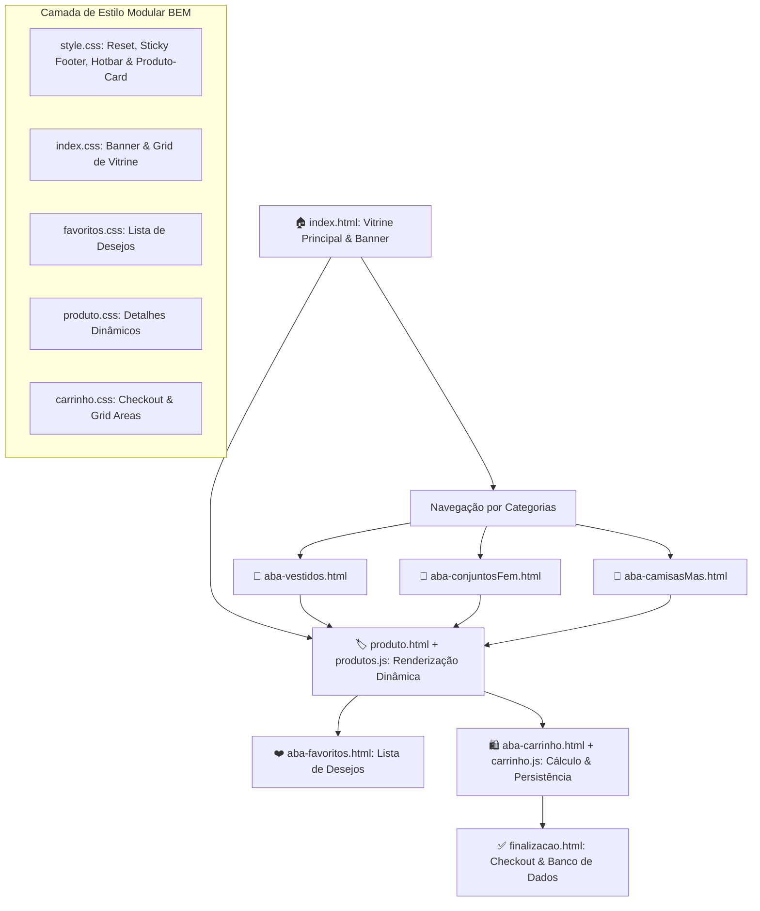

<div align="center">

# 🛍️ Lart's Rygussa — E-commerce de Moda

**Moda que expressa quem você é.**

> Loja virtual de moda masculina e feminina desenvolvida com **HTML5 semântico**, **CSS3** (Flexbox, Grid, BEM e Media Queries) e **JavaScript puro**, com renderização dinâmica de produtos, favoritos, carrinho persistente e integração com banco de dados.

🔗 **Site no ar:** [andrepierote.github.io/atividade-teams](https://github.io)


Trabalho final da disciplina **Programação Web — Web Coding** · Ciência da Computação

</div>

---

## 📌 Sumário

1. [Escopo e conformidade técnica](#-escopo-e-conformidade-técnica)
2. [Equipe](#-equipe)
3. [Sobre o projeto](#-sobre-o-projeto)
4. [Arquitetura e páginas](#-arquitetura-e-páginas)
5. [Estrutura de pastas](#-estrutura-de-pastas)
6. [HTML5 semântico e acessibilidade](#-html5-semântico-e-acessibilidade)
7. [Metodologia BEM](#-metodologia-bem)
8. [Flexbox](#-flexbox)
9. [CSS Grid Layout](#-css-grid-layout)
10. [Responsividade e Media Queries](#-responsividade-e-media-queries)
11. [Capturas de tela](#-capturas-de-tela)
12. [Banco de dados e persistência (ponto extra)](#-banco-de-dados-e-persistência-ponto-extra)
13. [Como executar](#-como-executar)

---

## 📋 Escopo e conformidade técnica

> **Nota de Implementação:** Toda a camada visual e estrutural foi construída nativamente com HTML5 e CSS3 puro, sem dependência de frameworks externos (como Bootstrap ou Tailwind), assegurando domínio completo sobre cascata, especificidade, posicionamento bidimensional e adaptação de viewport. As funcionalidades dinâmicas de vitrine, favoritos, carrinho e persistência foram implementadas em JavaScript e banco de dados.

---

## 👥 Equipe

| Integrante | GitHub | Responsável por |
| --- | --- | --- |
| **André Pierote** | [@andrepierote](https://github.com) | Vitrine inicial (`index.html`), páginas de categorias (`aba-vestidos.html`, `aba-conjuntosFem.html`, `aba-camisasMas.html`), arquitetura CSS modular e metodologia BEM |
| **Ricardo Araújo** | [@Ricardosantos360](https://github.com) | Página dinâmica de detalhes do produto (`produto.html`), estilização (`produto.css`) e lógica JavaScript |
| **Carlos Eduardo** | [@Carlos-MNK](https://github.com) | Fluxo de carrinho e finalização (`aba-carrinho.html`, `finalizacao.html`), estilos (`carrinho.css`) e scripts (`carrinho.js`) |
| **Yan Elvis** | [@yanelvisdiasdias-del](https://github.com) | Página de lista de desejos (`aba-favoritos.html`) e estilização (`favoritos.css`) |
| **Henrique Abreu** | [@abreuhenrique](https://github.com) | Implementação e integração de banco de dados ao site |

---

## 🎯 Sobre o projeto

O **Lart's Rygussa** é um e-commerce de vestuário projetado para oferecer uma experiência completa e fluida de navegação e compra online. O usuário pode:

- explorar a vitrine principal dividida em **3 categorias** (Vestidos, Conjuntos Femininos e Camisas Masculinas);
- navegar pelas seções internas e abrir a ficha detalhada de qualquer peça;
- gerenciar uma lista de **favoritos**;
- adicionar produtos ao **carrinho**, alterar quantidades, remover itens e acompanhar o resumo financeiro atualizado automaticamente;
- concluir o pedido em uma etapa dedicada de **finalização** com dados integrados ao banco de dados.

---

## 🏗️ Arquitetura e páginas

O site é composto por **8 páginas HTML** interligadas pelos menus de navegação superior e institucional.

| Página | Arquivo | O que tem |
| --- | --- | --- |
| Início | `index.html` | Barra superior com marca e ícones utilitários (pesquisa, sacola e conta), menu de âncoras, banner editorial e vitrine com 18 produtos distribuídos em 3 categorias |
| Detalhes do Produto | `produto.html` | Página única reutilizável que recebe a peça selecionada e renderiza foto, descrição, preço e ações de compra via JavaScript |
| Vestidos | `aba-vestidos.html` | Seção dedicada ao catálogo feminino de vestidos |
| Conjuntos Femininos | `aba-conjuntosFem.html` | Seção dedicada aos conjuntos femininos |
| Camisas Masculinas | `aba-camisasMas.html` | Seção dedicada às camisas e camisetas masculinas |
| Favoritos | `aba-favoritos.html` | Lista de desejos do usuário com tratamento visual para estado vazio e botão de retorno ao catálogo |
| Carrinho | `aba-carrinho.html` | Lista interativa de itens selecionados, controle de quantidade, remoção e painel lateral com subtotal e total |
| Finalização | `finalizacao.html` | Formulário de checkout e tela de confirmação da compra |



A página de Detalhes (`produto.html`) é única para todo o catálogo: o script identifica a peça selecionada e preenche a interface dinamicamente, evitando a duplicação de arquivos HTML.

---

## 📂 Estrutura de pastas

```text
atividade-teams/
├── css/
│   ├── style.css             # estilos globais: reset, sticky footer, hotbar, navegação, cards e rodapé
│   ├── index.css             # página inicial: banner editorial, catálogo e media queries da vitrine
│   ├── favoritos.css         # página de favoritos e estado de lista vazia
│   ├── produto.css           # página de detalhes dinâmicos do produto
│   └── carrinho.css          # carrinho de compras, resumo sticky e formulário de finalização
├── js/
│   ├── produtos.js           # catálogo de dados e renderização dinâmica do produto
│   └── carrinho.js           # lógica de adição, cálculo de valores e persistência
├── imagens/
│   ├── icons/                # ícones utilitários (lupa, sacola, usuário)
│   ├── pag 2/                # imagens editoriais e banner principal
│   ├── produto/              # fotografias das peças do catálogo
│   └── prints/               # capturas de tela em 1366, 768 e 375 px
├── index.html
├── produto.html
├── aba-vestidos.html
├── aba-conjuntosFem.html
├── aba-camisasMas.html
├── aba-favoritos.html
├── aba-carrinho.html
├── finalizacao.html
└── README.md
```

Todo o CSS é externo e modularizado. Cada página carrega apenas as folhas de estilo necessárias para o seu contexto, eliminando conflitos de especificidade.

---

## 🧱 HTML5 semântico e acessibilidade

Todas as páginas seguem uma hierarquia semântica padronizada:

```html
<header>
  <nav class="hotbar">…</nav>                <!-- marca + ícones utilitários -->
</header>
<nav class="navegacao" aria-label="Navegação principal">…</nav>
<main>…</main>                                <!-- seções e artigos do catálogo -->
<footer class="rodape">…</footer>
```

| Elemento | Onde aparece |
| --- | --- |
| `<header>` e `<nav>` | Cabeçalho principal (`.hotbar`), menu de âncoras (`.navegacao`) e cabeçalho do fluxo de compra |
| `<main>` | Conteúdo principal de todas as páginas (configurado com `flex: 1` para manter o rodapé ancorado na base) |
| `<section>` | Banner principal, catálogo geral, blocos de cada categoria (Vestidos, Conjuntos, Camisas) e lista de favoritos |
| `<article>`, `<figure>` e `<figcaption>` | Estruturação individual de cada card de produto (`.produto-card`) com imagem, divisor e legenda de preço |
| `<aside>` | Painel lateral de resumo financeiro na página do carrinho (`.resumo`) |
| `<footer>` | Rodapé institucional presente em todas as páginas |

Recursos de acessibilidade aplicados:

- link de salto direto para o conteúdo (`.pular-conteudo`) no fluxo de compra;
- `aria-label` e `aria-labelledby` identificando regiões de navegação, listas de produtos e resumo;
- `aria-live="polite"` e `role="status"` para anunciar mensagens dinâmicas no carrinho;
- `:focus-visible` com contorno de alto contraste (`3px solid #9b570c`) para navegação por teclado;
- atributo `alt` descritivo em todas as imagens e ícones.

---

## 🏷️ Metodologia BEM

As classes CSS seguem rigorosamente o padrão **bloco**, **bloco__elemento** e **bloco--modificador**, desacoplando a estilização das tags HTML.

| Bloco | Elementos | Modificadores |
| --- | --- | --- |
| `hotbar` | `__logo`, `__lista` | — |
| `navegacao` | `__lista`, `__link` | — |
| `banner` | `__titulo`, `__imagem` | — |
| `catalogo` | `__titulo`, `__divisor`, `__secao`, `__cabecalho`, `__categoria-titulo`, `__ver-mais`, `__produtos` | — |
| `produto-card` | `__figura`, `__imagem`, `__divisor`, `__legenda` | — |
| `favoritos` | `__titulo`, `__divisor`, `__vazio`, `__icone`, `__link` | — |
Use o código com cuidado.
| carrinho | __item, __imagem, __dados, __nome, __detalhe, __acoes, __quantidade, __remover, __vazio | — |
| resumo | __linha, __produto, __voltar | resumo__linha--total |
| botao | — | botao--principal |
Exemplo real do card de produto utilizado na vitrine (index.html):
html <article class="produto-card"> <figure class="produto-card__figura">  <hr class="produto-card__divisor"> <figcaption class="produto-card__legenda"> Vestido alcinhas <br> R$ 384,90 </figcaption> </figure> </article> 
Observação: O fluxo de compra (carrinho.css) utiliza blocos prefixados com loja- (.loja-cabecalho, .loja-rodape) para isolar o visual editorial do checkout sem interferir na vitrine principal.

↔️ Flexbox

O Flexbox organiza os alinhamentos unidirecionais em todo o projeto, contemplando display: flex, flex-direction, justify-content, align-items, flex-wrap e gap.

Área	Arquivo · seletor	Propriedades principais
Sticky Footer (rodapé sempre na base da tela)	style.css · body	display: flex, flex-direction: column, min-height: 100vh
Cabeçalho: marca na esquerda e ícones na direita	style.css · .hotbar	display: flex, justify-content: space-between, align-items: center
Lista de ícones utilitários	style.css · .hotbar__lista	display: flex, gap: 30px
Menu de âncoras da vitrine	style.css · .navegacao, .navegacao__lista	display: flex, justify-content: center, gap: 30px
Banner de boas-vindas	index.css · .banner	display: flex, flex-direction: column, align-items: center
Cabeçalho de cada categoria (título + botão Ver mais)	index.css · .catalogo__cabecalho	display: flex, justify-content: space-between, align-items: center
Estado vazio da lista de favoritos	favoritos.css · .favoritos__vazio	display: flex, flex-direction: column, align-items: center, gap: 15px
Cards horizontais dos itens no carrinho	carrinho.css · .carrinho__item	display: flex, flex-wrap: wrap, align-items: center, gap: 20px


🔲 CSS Grid Layout

O Grid organiza as estruturas bidimensionais do catálogo e do carrinho, utilizando display: grid, grid-template-columns, grid-template-areas, repeat(), minmax() e gap.

Área	Arquivo · seletor	Propriedades principais
Grade de produtos por categoria (6 cards cada)	index.css · .catalogo__produtos	display: grid, grid-template-columns: repeat(3, minmax(0, 1fr)), gap: 25px
Estrutura principal do carrinho e checkout	carrinho.css · .compra__layout	display: grid, grid-template-columns: minmax(0, 2fr) minmax(270px, 1fr), grid-template-areas: "conteudo resumo", gap: 30px
Grade de campos do formulário de finalização	carrinho.css · .formulario__grade	display: grid, grid-template-columns: repeat(2, minmax(0, 1fr)), gap: 18px

```css
/* index.css: grade responsiva com 3 colunas proporcionais no desktop */
.catalogo__produtos {
display: grid;
grid-template-columns: repeat(3, minmax(0, 1fr));
gap: 25px;
}
/* carrinho.css: divisão explícita por áreas entre lista e resumo */
.compra__layout {
display: grid;
grid-template-columns: minmax(0, 2fr) minmax(270px, 1fr);
grid-template-areas: "conteudo resumo";
gap: 30px;
}
```

📱 Responsividade e Media Queries

O site foi testado em 375 px (celular), 768 px (tablet) e 1366 px (computador), sem rolagem horizontal, textos cortados ou elementos sobrepostos, utilizando 3 faixas de @media screen.

Arquivo	Breakpoints	O que muda
style.css	max-width: 768px · max-width: 480px	Cabeçalho Flexbox passa de linha para coluna no celular (flex-direction: column), navegação quebra linha com flex-wrap: wrap e altura das imagens dos cards ajusta progressivamente (490px → 390px → 190px)
index.css	min-width: 1024px · max-width: 768px · max-width: 480px	Grade de produtos converte de 3 colunas (desktop) para 2 colunas (repeat(2, minmax(0, 1fr))), largura máxima controlada em 1366px e ajuste proporcional de títulos e botões
carrinho.css	min-width: 768px · max-width: 768px · max-width: 480px	Resumo financeiro fixo (position: sticky) no desktop, empilhamento vertical entre lista e resumo em tablets e formulário de checkout em 1 coluna no celular

Outros cuidados aplicados: <meta name="viewport"> em todas as páginas, tipografia fluida com clamp(), object-fit: cover nas fotografias e max-width: 100%.

🖼️ Capturas de tela


Computador (1366 px)	Tablet (768 px)	Celular (375 px)		


💾 Banco de dados e persistência (ponto extra)

Para proporcionar uma experiência realista e completa de e-commerce:
• Catálogo dinâmico (produtos.js): centraliza os metadados das peças (nome, preço, categoria, descrição e imagem) para alimentar dinamicamente a página única de detalhes (produto.html).
• Carrinho persistente (carrinho.js + localStorage): salva os itens adicionados, quantidades e cálculos de subtotal no armazenamento local do navegador, mantendo o estado mesmo após atualizar ou fechar a aba.
• Integração com Banco de Dados: estruturação de persistência para armazenamento dos registros de produtos, clientes e pedidos realizados na loja.

🚀 Como executar

Online: acesse andrepierote.github.io/atividade-teams.
Localmente:
1. Clone o repositório:
   bash git clone https://github.com cd atividade-teams    
2. Abra a pasta no Visual Studio Code e execute o index.html com a extensão Live Server (ou abra o arquivo diretamente no navegador).
© 2026 Lart's Rygussa — Moda que expressa quem você é.
